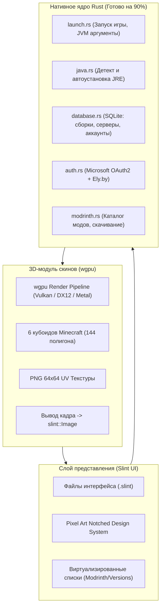

# Omega Launcher — Дорожная карта перехода на Native Slint + Rust (`NATIVE_SLINT_ROADMAP.md`)

Данный документ представляет собой детальный архитектурный план и пошаговую инструкцию по созданию ультра-производительной, независимой от браузеров нативной версии **Omega Launcher** на базе **Rust + Slint + wgpu**.

---

## 1. Миссия и цели перехода

Текущая версия Omega Launcher на базе **Tauri v2 + WebKitGTK/WebView2** показала отличные результаты среди веб-лаунчеров (~180–190 МБ ОЗУ против 800–1100 МБ у Electron-лаунчеров вроде CurseForge/Modrinth). 

Однако переход на полностью нативный стек преследует три фундаментальные цели:

1. **Рекордное потребление памяти:** Снижение потребления ОЗУ с ~190 МБ до **25–35 МБ** в открытом окне и **10–12 МБ** во время игры в Minecraft (сворачивание в фоновый трей-процесс).
2. **Мгновенный отклик (0.05 сек):** Запуск за доли секунды без необходимости инициализации движков WebKit, WebView2 или Chromium.
3. **Zero External Dependencies (Абсолютная независимость от ОС):** Устранение зависимости от системного `webkit2gtk` на Linux и `WebView2` на Windows. Лаунчер компилируется в один монолитный бинарник, который одинаково работает на любом дистрибутиве Linux (Arch, Ubuntu, Fedora, Alpine), Windows 10/11 и macOS.

---

## 2. Сравнение архитектур: Tauri vs Native Slint

| Параметр | Текущая версия (Tauri v2) | Новая версия (Native Slint + wgpu) |
| :--- | :---: | :---: |
| **UI-движок** | WebKitGTK (Linux) / WebView2 (Win) | **Slint (нативный рендер через Skia/FemtoVG)** |
| **3D-графика** | WebGL / Three.js (в браузере) | **wgpu (Vulkan / DirectX 12 / Metal)** |
| **Потребление ОЗУ (покой)** | ~180–190 МБ | **~25–35 МБ** (в 5–7 раз меньше!) |
| **Потребление ОЗУ (во время игры)**| ~140–180 МБ (если окно не закрыто) | **~10–12 МБ** (полное освобождение ресурсов) |
| **Скорость запуска** | ~0.8 – 1.2 секунды | **~0.05 секунды** (мгновенно, как блокнот) |
| **Вес бинарника** | ~8–12 МБ (без Webview) | **~15–20 МБ** (всё включено в один файл) |
| **Системные зависимости** | Требует `libwebkit2gtk-4.1` в ОС | **0 зависимостей** (полная изоляция) |
| **Процессы в Диспетчере задач**| 3 процесса (Web + Network + Core) | **1 единственный процесс** |

---

## 3. Технологический стек



* **Язык разработки:** Rust (2021 edition).
* **UI-фреймворк:** [Slint](https://slint.dev/) (декларативный, компилируется напрямую в машинный код C++/Rust, поддержка кастомных шейдеров и отрисовки).
* **3D-графика персонажа:** `wgpu` (WebGPU реализация на Rust).
* **Асинхронность и сеть:** `tokio` + `reqwest` (многопоточная параллельная загрузка файлов модов и версий со скоростью диска).
* **База данных:** `rusqlite` (хранение локальных профилей, серверов и настроек).

---

## 4. Пошаговые фазы реализации

### Фаза 0: Подготовка репозитория и безопасность
- [ ] Создать отдельную ветку разработки:
  ```bash
  git checkout -b native-slint
  ```
- [ ] Оставить ветку `master` с рабочей версией Tauri в неприкосновенности.
- [ ] Создать директорию `native-ui/` или настроить Cargo Workspace в корне репозитория:
  - `crates/omega-core/` — сюда переносится вся существующая чистая бизнес-логика из `src-tauri/src/` (`launch.rs`, `java.rs`, `auth.rs` и т.д.).
  - `crates/omega-slint/` — приложение на Slint.

---

### Фаза 1: Hello Slint & Замер реального потребления памяти
- [ ] Настроить базовый `Cargo.toml` с зависимостями `slint = "1.9"`, `slint-build = "1.9"`.
- [ ] Создать минимальное тестовое окно `ui/app.slint` с тёмным фоном и заголовком «Omega Launcher».
- [ ] Скомпилировать бинарник в релизе:
  ```bash
  cargo build --release
  ```
- [ ] Провести замеры памяти через `/proc` и `htop` на твоём ноутбуке.
- [ ] **Критерий приёмки фазы 1:** Память чистого окна в режиме покоя строго **до 30 МБ ОЗУ**.

---

### Фаза 2: Фирменная дизайн-система Omega на Slint
Перенести уникальную визуальную идентичность Omega Launcher:
- [ ] **Цветовая палитра:**
  - Obsidian фоны: `#07080e`, `#090c14`, `#0c0f1b`, `#111626`.
  - Акценты: Изумрудный (`#10b981`), Сиреневый (`#9f75ff`), Синий сапфир (`#1d5dc7`).
- [ ] **Ступенчатые вырезы (Notched Pixel Borders):**
  - Реализовать базовый виджет `NotchedCard` и `NotchedButton` в `.slint` с аутентичными 6px срезанными уголками Minecraft.
- [ ] **Шрифты:**
  - Подключить пиксельный шрифт Minecraft и шрифт интерфейса (Inter / JetBrains Mono).
- [ ] **Аутентичные 16x16 иконки:**
  - Перенести пиксельные иконки алмазного меча, кирки, обсидиана, тотема из существующего `MinecraftIcons.tsx`.

---

### Фаза 3: Главный экран (Home Screen) & Запуск Minecraft
- [ ] Создать нижний док (`DockLayer`):
  - Кнопка выбора активной сборки/версии.
  - Большая кнопка «ИГРАТЬ» (сиреневая `#9f75ff`) с анимацией нажатия.
  - Индикатор состояния (запуск, скачивание библиотек, PID игры).
- [ ] Подключить готовый модуль `launch.rs`:
  - Чтение путей Java.
  - Формирование аргументов JVM и GC (G1GC / ZGC / Shenandoah).
  - Спавн процесса Minecraft через `std::process::Command`.
- [ ] **Режим гибернации (Сворачивание в трей):**
  - При запуске игры окно Slint полностью скрывается (`window.hide()`), рендер останавливается.
  - В памяти остаётся легковесный Rust-поток, ожидающий завершения процесса игры (потребление **10–12 МБ**!).
  - При закрытии игры окно лаунчера мгновенно появляется вновь.

---

### Фаза 4: 3D Скин-модуль на `wgpu` (Скины и Плащи)
Перенос функционала персонажа без использования тяжелого Three.js:
- [ ] **Геометрия модели:**
  - Описать 6 базовых кубоидов персонажа:
    - Голова: `8 x 8 x 8`
    - Тело: `8 x 12 x 4`
    - Левая и правая рука: `4 x 12 x 4`
    - Левая и правая нога: `4 x 12 x 4`
    - Плащ: тонкая пластина `10 x 16 x 1`
  - Добавить второй слой одежды (hat, jacket, sleeves, pants).
- [ ] **UV-развёртка:**
  - Наложить стандартную карту текстуры скина `64x64` PNG.
- [ ] **Анимация суставов:**
  - Перенести математику синусоид ходьбы и качания рук/ног из `roamingCharacter.ts`.
- [ ] **Интерактивность:**
  - Поворот головы и тела за положением мыши.
- [ ] **Вывод в Slint:**
  - `wgpu` рендерит сцену в текстуру кадра (Render Target).
  - Кадр конвертируется в `slint::Image` через `slint::Image::from_rgba8` со стабильными 60 FPS.

---

### Фаза 5: Система аккаунтов (Microsoft, Ely.by, Offline)
- [ ] **Офлайн-аккаунты:**
  - Добавление любого никнейма в один клик.
  - Локальная привязка кастомных PNG-скинов.
- [ ] **Microsoft OAuth2:**
  - Использовать уже написанный Device Code Flow из `auth.rs`.
  - Получение токена Mojang, никнейма и официального скина с плащами.
- [ ] **Ely.by авторизация:**
  - Получение скинов игроков через публичный Ely.by API.

---

### Фаза 6: Каталог Modrinth & CurseForge
- [ ] Создать асинхронный сервис запросов к `https://api.modrinth.com/v2/search`.
- [ ] Сверстать карточки модов в `.slint` с поддержкой тегов версий (Fabric, Forge, NeoForge).
- [ ] Реализовать виртуализированный бесконечный скролл (загрузка пачками по 15 модов).
- [ ] Фоновое скачивание `.jar` файлов модов с отображением полосы прогресса прямо в карточке.

---

### Фаза 7: Консоль логов и Настройки
- [ ] Экран настроек:
  - Слайдер выделения оперативной памяти для Minecraft (1 ГБ – 16 ГБ).
  - Выбор версии Java (автодетект системных рантаймов из `java.rs`).
  - Выбор сборщика мусора JVM.
- [ ] Экран консоли:
  - Прямой перехват `stdout` и `stderr` запущенного процесса игры.
  - Буфер на 500 строк с подсветкой синтаксиса (`[INFO]`, `[WARN]`, `[ERROR]`).

---

## 5. Пример кода: Как пишется интерфейс в Slint

Синтаксис `.slint` максимально прост и объединяет лучшее из CSS, React и QML:

```slint
import { Button } from "std-widgets.slint";

export component PlayDock inherits Rectangle {
    in-out property <string> version-name: "1.20.1 (Fabric)";
    in-out property <bool> is-running: false;
    callback play-clicked();

    height: 72px;
    background: #090c14;
    border-width: 2px;
    border-color: #1e293b;
    border-radius: 8px;

    HorizontalLayout {
        padding-left: 20px;
        padding-right: 20px;
        spacing: 16px;
        alignment: space-between;

        // Селектор версии
        VerticalLayout {
            alignment: center;
            Text {
                text: root.version-name;
                color: #ffffff;
                font-size: 16px;
                font-weight: 700;
            }
            Text {
                text: "Готово к запуску";
                color: #10b981;
                font-size: 12px;
            }
        }

        // Большая кнопка запуска
        Rectangle {
            width: 160px;
            height: 48px;
            background: root.is-running ? #ef4444 : #9f75ff;
            border-radius: 6px;

            TouchArea {
                clicked => { root.play-clicked(); }
            }

            Text {
                text: root.is-running ? "ОСТАНОВИТЬ" : "ИГРАТЬ";
                color: #000000;
                font-size: 15px;
                font-weight: 800;
                horizontal-alignment: center;
                vertical-alignment: center;
            }
        }
    }
}
```

---

## 6. Связка Slint с существующим Rust-бэкендом

Вся мощь Slint раскрывается в том, что он компилируется прямо в нативный код Rust без какого-либо веб-моста (IPC):

```rust
slint::include_modules!();

#[tokio::main]
async fn main() -> Result<(), Box<dyn std::error::Error>> {
    let ui = MainWindow::new()?;

    // Прямой вызов нашей существующей функции launch_minecraft из launch.rs!
    let ui_handle = ui.as_weak();
    ui.on_play_clicked(move || {
        let ui = ui_handle.unwrap();
        println!("Запуск Minecraft через нативный Rust!");
        
        // Запускаем Minecraft и скрываем окно в трей
        tokio::spawn(async move {
            omega_core::launch::launch_game("1.20.1").await;
        });
    });

    ui.run()?;
    Ok(())
}
```

---

## 7. Заключение и ожидаемый результат

Реализация данной дорожной карты выведет **Omega Launcher** в высшую лигу системного ПО:
1. Лаунчер будет потреблять **в 30 раз меньше памяти, чем CurseForge/Modrinth (25 МБ против 800+ МБ)**.
2. Он будет запускаться **в 10 раз быстрее любого веб-лаунчера**.
3. Он будет работать одинаково плавно даже на слабых ноутбуках с 2 ГБ или 4 ГБ ОЗУ.
4. Проект станет эталоном современного, красивого и бескомпромиссно быстрого ПО на языке Rust.
